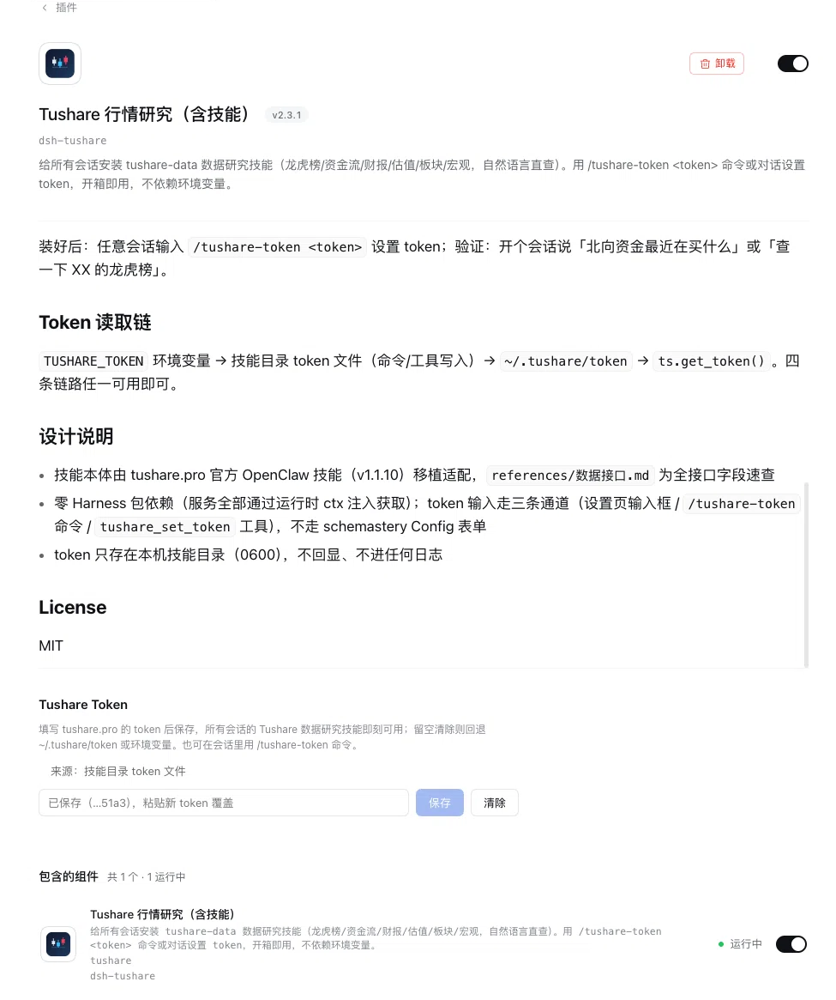

# dsh-tushare · Tushare 行情研究（含技能）

DeepSeek Harness（DSH）插件：**给所有会话安装 tushare-data 数据研究技能**，并在插件设置里提供 Tushare Token 输入框——填一次 token，所有会话开箱即用。从龙虎榜、北向资金、打板情绪到宏观跨市场，中文自然语言直接出研究结论和数据文件。

## 功能

### 1. 完整数据研究技能，装完即用

插件启用后自动把 `tushare-data` 数据研究技能同步到 `~/.dsh/skills/tushare-data/`，**所有会话即刻可用**。技能由 tushare.pro 官方 OpenClaw 技能（v1.1.10）移植适配，完整保留全部能力。

**10 类研究意图，中文自然语言直达**：行情/趋势 · 标的识别 · 财务/公司质量 · 估值/基本面 · 资金流/市场行为 · 板块/指数/主题 · 打板/情绪/活跃度 · 公告/新闻/研报/政策 · 宏观/跨市场 · 数据导出

**特色数据一网打尽**：

- **龙虎榜**：`top_list` 个股上榜 + `top_inst` 营业部买卖明细
- **北向/沪深港通**：`moneyflow_hsgt` 资金流向、`hsgt_top10` 活跃股排行，另有主力资金流 `moneyflow` 与板块资金流（东财口径）
- **打板情绪面**：涨停/跌停列表 `limit_list_d`、连板梯队 `limit_step`、开盘啦 `kpl_list`、东财/同花顺热榜 `dc_hot`/`ths_hot`
- **板块三口径**：申万行业、同花顺概念、东财板块任选，成分股/资金流/涨停梯队联动分析
- **财报事件链**：业绩预告 `forecast`、业绩快报 `express`、披露时间表 `disclosure_date`、互动易/上证 e 互动问答
- **两融及转融通**：37 个接口全覆盖；**债券专题** 82 个接口
- **宏观全家桶 + 跨市场**：CPI/PPI/PMI/GDP/M2/社融、Shibor/LPR、美债收益率，港股/美股/全球指数
- **分钟线与实时**：`stk_mins` 历史分钟，`rt_k`/`rt_min` 实时口径（按权限）

**9 大研究工作流模板（不止查数，直接出结论）**：

| 工作流 | 口语示例 |
|---|---|
| 单标的行情分析 | 「看下 XX 最近怎么样」 |
| 多标的横向对比 | 「比一下茅台、五粮液、泸州老窖近一年涨幅和估值」 |
| 财务质量快照 | 「比亚迪最近 8 个季度营收利润趋势」 |
| 估值分析/筛选 | 「筛一批高 ROE 低负债的公司」 |
| 资金流追踪 | 「北向最近在买什么」 |
| 板块/题材轮动 | 「最近哪个板块最强，强在哪些票」 |
| 公告/事件梳理 | 「帮我梳理下寒武纪最近的重要公告」 |
| 数据导出与研究准备 | 「沪深300成分股近两年日线导成 CSV」 |
| 综合研究简报 | 「快速研究一下 XX，给个全景判断」 |

**工程化数据纪律**（不是只会调接口）：

- 模糊口语自动落到合理口径：「最近」→ 近 20 交易日、「财报」→ 近 8 季度+年度、「强不强」→ 走势+相对强弱+活跃度
- 长区间自动分段拉取、限流重试、断点续跑、基础表缓存复用
- 输出契约固定：一句话结论 + 数据口径 + 关键表格 + 风险点 + 文件路径
- 空结果会区分非交易日/未上市/无权限，不会把空表说成「接口坏了」
- 导出 CSV/Parquet 附元信息（接口名、参数、拉取时间、行数、失败分段），可直接进回测
- **229 个接口字段速查**（`references/数据接口.md`）：股票参考、债券、两融转融通、ETF/基金、宏观、行业经济、大模型语料全分类
- **速查 CLI `scripts/tsq.py`（首选）**：`lhb`（龙虎榜+营业部明细）/ `dv`（估值交叉）/ `mf`（大单结构，联动日线补涨跌幅）/ `fina`（财务复核）/ `daily` / `smoke` 六个子命令——token 三路自动解析、统一 markdown 紧凑表（单位换算为亿）、已知接口坑全部内置规避；另有 `stock_data_demo.py` / `fund_data_demo.py` 演示脚本

### 2. Token 管理（三条通道）
   - **设置页输入框（推荐）**：**设置 → 插件 → Tushare** 页签，粘贴 token 点保存（插件自带该页签）
   - 任意会话输入命令：**`/tushare-token <你的token>`**（`/tushare-token` 查看来源状态，`/tushare-token clear` 清除）
   - 或直接对 AI 说「**把 tushare token 设为 xxx**」（调用 `tushare_set_token` 工具）
   - token 自动写入技能目录（0600 权限），技能脚本开箱即用；清除则回退 `~/.tushare/token` 或环境变量 `TUSHARE_TOKEN`

## 界面预览

插件详情页内置 Tushare Token 设置面板（状态指示 / 保存 / 清除）：

## 安装（三种方式任选）

1. **npm 包（推荐）**：对本机 DSH 里的 AI 说：**用 plugin_manager 的 install_bundle 安装 dsh-tushare**（target 给 `dsh-tushare@<版本号>`）
2. **Git 钉扎**：install_bundle target 给 `github:runweok/dsh-tushare#<commit>`（锁定具体 commit，适合复现）
3. **市场索引订阅**：仓库根 `index.json`（format-1）发布后，可经 raw.githubusercontent 索引源订阅，Discover 搜索可见

装好后：任意会话输入 `/tushare-token <token>` 设置 token；验证：开个会话说「北向资金最近在买什么」或「查一下 XX 的龙虎榜」。

## Token 读取链

`TUSHARE_TOKEN` 环境变量 → 技能目录 token 文件（命令/工具写入）→ `~/.tushare/token` → `ts.get_token()`。四条链路任一可用即可。

## 积分与权限：免费 / 付费的区别

插件本身免费开源，限制来自 Tushare Pro 平台的积分制度。官方口径：[关于权限](https://tushare.pro/document/1?doc_id=108) · [积分获取](https://tushare.pro/document/1?doc_id=13) · [积分频次表](https://tushare.pro/document/1?doc_id=290)（2026-11 拉取，如有调整以官方为准）。

### 两种权限模式

1. **积分门槛接口**：积分达标即可调取，不消耗积分；每分钟频次随积分档提高
2. **独立权限接口**：分钟数据、新闻、公告、互动易、研报库、美股/港股等**单独购买**，与积分无关

### 档位对照（官方表一）

| 档位 | 价格 | 每分钟频次 | 每天总量 | 能干什么 |
|---|---|---|---|---|
| **免费 120 分** | 0 元 | 50 次/分 | 8000 次/天 | **仅非复权日线 `daily`**，其余接口均无法调取 |
| **2000 分** | 200 元/年 | 200 次/分 | 10 万次/个 API | 本插件主力能力全开（见下） |
| **5000 分** | 500 元/年 | 500 次/分 | 常规数据无上限 | 同上 + 更高频次 |
| **10000 分** | 1000 元/年 | 500 次/分 | 常规无上限、特色 300 次/分 | + 特色数据：盈利预测、每日筹码和胜率、筹码分布、券商月度金股 |
| **15000 分** | 1500 元/年 | 500 次/分 | 特色数据无总量限制 | 特色数据专属 |

### 对本插件功能的具体影响

- **免费档（120 分）**：只有「XX 最近走势」类基础日线可用。插件主打的**龙虎榜 `top_list`/`top_inst`、资金流 `moneyflow`、估值 `daily_basic`、财务 `income`/`fina_indicator`/`forecast`/`express`、财报披露日历、指数/申万板块、基金、可转债、shibor 等全部在 2000 分档**——免费档基本用不了「三件套补位」
- **2000 分档**：上述主力接口全部可用（个人 200 元/年，1 元 = 10 积分）
- **周线/月线/复权 `pro_bar`**：2000 分；**个股分钟线**：独立权限 2000 元/年
- **公告 / 新闻 / 互动易·e 互动 / 券商研报库**：独立权限（500~1000 元/年各算各的）——技能里的「公告/事件梳理」意图需要对应权限才可用
- **筹码分布 / 盈利预测 / 金股**：10000 分档（1000 元/年）

### 积分怎么获得

- **免费**：注册送 100 分，修改个人真实资料 +20（凑过 120 门槛）；推荐注册 +50/人；贡献代码 100~500、提交 bug 5~50、发表 Tushare 文章 100~1000；在校学生/高校教师有专门通道
- **付费**：日常购买 1 元 = 10 积分；微信专业用户群送 5000 分；积分与购买的权限**一年有效期**（一年内不消耗不扣减），购买不支持退款；机构价为个人 10 倍

### 插件内的提示机制

- 技能指令内置权限前置检查：高权限接口调用前主动提示积分限制，避免跑失败才暴露
- `tsq.py` 速查 CLI：权限/积分不足时以**退出码 3** + 人话提示报告，参数错误退出码 2
- 档位相关的行为差异（如龙虎榜必传 `trade_date`）沉淀在 SKILL.md「已知接口坑」节，踩过的坑不会重踩

## 设计说明

- 技能本体由 tushare.pro 官方 OpenClaw 技能（v1.1.10）移植适配，`references/数据接口.md` 为 229 个接口的字段/参数速查表
- 零 Harness 包依赖（服务全部通过运行时 ctx 注入获取）；token 输入走三条通道（设置页输入框 / `/tushare-token` 命令 / `tushare_set_token` 工具），不走 schemastery Config 表单
- token 只存在本机技能目录（0600），不回显、不进任何日志

## License

[MIT](LICENSE)
